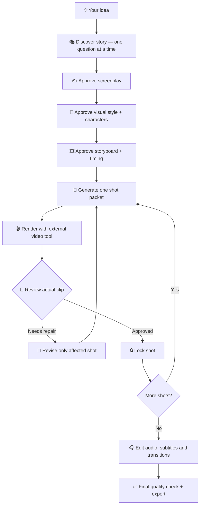

<div align="center">

# 🎬 Universal AI Film Director

### From a rough idea to a production-ready AI film — with an AI director that actually follows your decisions.

**A portable, multi-agent filmmaking skill for storytelling, screenwriting, storyboarding, visual continuity, video-generation prompts, sound design, shot review, and editing.**

[](LICENSE)


[](https://github.com/montadhahri/universal-ai-film-director/actions/workflows/validate.yml)

[**Roadmap**](docs/ROADMAP.md) · [**Flagship demo**](examples/flagship-film/README.md) · [**Release readiness**](docs/release-checklist.md) · [**Changelog**](CHANGELOG.md) · [**Get started**](#-quick-start) · [**Install**](#-installation-by-agent) · [**Full example**](#-complete-walkthrough-a-90-second-film) · [**File guide**](#-what-each-file-does) · [**Troubleshooting**](#-troubleshooting) · [**Contribute**](CONTRIBUTING.md)

</div>

---

## ✨ What is this?

Most AI video prompts describe *one clip*. A film needs much more: a story that works, consistent characters, a plan for dozens of shots, sound, revisions, and a final edit.

**Universal AI Film Director** turns a compatible AI assistant into a **collaborative film director**. It asks **one question at a time**, records decisions in a **Project Bible**, requests approval at major milestones, writes **generator-ready shot packets**, and helps you fix individual shots **without silently rewriting approved scenes**.

> **Important:** This repository is a set of agent instructions, reference guides, templates and illustrative examples. It does **not** render video, install a video model, connect to Google Flow automatically, guarantee identical characters, or produce a finished film without external generation/editing tools.

### What you can make

| Format | Example | Key consideration |
|---|---|---|
| Stickman / minimalist 2D | Personal journey or comedy | Readable motion and consistent character details |
| 2D / 3D animation | Fantasy adventure | Model sheets, proportions and style continuity |
| Cinematic / photorealistic | Short fiction | Lighting, casting and shot-to-shot identity |
| Documentary-style | Historical explainer | Factual sourcing and clear dramatization labels |
| Corporate / presentation | Team introduction | Audience suitability, privacy and pacing |
| Educational | Concept explanation | Clarity, timing and accurate content |

Works with **short clips or long-form film plans**. A 10-minute film typically needs many separately generated shots and external editing.

## 🧭 How it works



**Approval gates:** screenplay → style bible → storyboard → shot-by-shot review. The agent must not pretend a shot was generated or inspected if it wasn't.

## ⚡ Quick start

**No coding required** if your AI agent can read Markdown files.

1. Install using the Skills CLI (Node.js/npm required; authenticate GitHub first for this private repository):
   ```bash
   npx skills add montadhahri/universal-ai-film-director -g
   ```
   Select your supported agent when prompted. For a project-local installation, omit `-g`.
   If the CLI cannot access the repository or your agent does not support native
   skills, use the [manual installation fallback](#universal-manual-method).
2. See [installation options](#-installation-by-agent) to target a particular agent, update the skill or install manually.
3. Start with this request:
   > Use the Universal AI Film Director skill. Help me make a 10-minute emotional stickman film for a workplace audience, using Google Flow for video clips. Ask one question at a time. Do not write video prompts before I approve the screenplay and storyboard.
4. Answer the agent's first question. Approve each major stage.
5. Copy the resulting shot prompts into your video generator, review the clips and assemble the film in an editor.

**Expected first response:** a brief introduction and **one** question: *“What story do you want this film to tell?”* If the agent produces an entire script immediately, ask it to reload `SKILL.md` and follow the interaction contract.

## 📦 Installation by agent

### Recommended: Skills CLI (npx)

Use the [open-source Skills CLI](https://www.skills.sh/docs/cli) to install the
skill into supported coding agents. **Node.js and npm are required**; the CLI
is not a video generator.

```bash
# Interactive installation to a user-level location (across projects)
npx skills add montadhahri/universal-ai-film-director -g

# Interactive installation in the current project (default)
npx skills add montadhahri/universal-ai-film-director

# Target particular agents at user scope
npx skills add montadhahri/universal-ai-film-director -g -a claude-code -a codex

# Inspect discovered skills before installing
npx skills add montadhahri/universal-ai-film-director --list

# Check and update installed skills
npx skills check
npx skills update -g
```

**Scope:** `-g` means user-level installation for **selected supported agents**,
available across their projects. It does **not** install the skill into every LLM
application or automatically activate it in ChatGPT web/app. Agent discovery
and reload behavior depend on each agent and its version.

**Private repository:** This repository currently requires GitHub access.
Configure Git credentials, `gh auth login`, or SSH before installing. The CLI
supports authenticated private GitHub sources; it cannot bypass access control.
For an SSH source, use
`npx skills add git@github.com:montadhahri/universal-ai-film-director.git -g`.

**Compatibility:** Installation support is not a claim of end-to-end testing.
The repository has a root `SKILL.md`; confirm discovery with `--list` and
verify the skill appears in your agent after installation. If discovery fails,
use the existing manual method below.

### Runtime requirements and development tools

**Python is not required to install or use this skill.** No pip, pytest, virtual environment, or Python packages are needed for runtime or development. Maintainer CI uses Node.js 22 built-in tools. The skill consists of `SKILL.md` and supporting Markdown/templates, interpreted by a compatible AI agent.

| Tool or file | End-user requirement | Maintainer requirement |
| --- | --- | --- |
| Python / pip | No | None: Node.js built-in tests run repository validation |
| Node.js / npm / npx | Only for the Skills CLI installation command | Optional installation smoke testing |
| SKILL.md and referenced resources | Yes | Yes |
| tests/ and .github/workflows/ | No | Used for quality checks |
| GitHub authentication | Required to fetch this private repository | Required for private repository access |
| Video or audio generation tools | Only for actual media generation | Required for real-media integration tests |

After installation, the skill instructions require neither Python nor Node.js; the host agent may have its own requirements. A global `-g` install applies to selected compatible agents, not every LLM product.

**Packaging caveat:** We have not verified which files the Skills CLI copies from this private repository. The installer may include maintainer files; that does not mean they execute. Check `--list` and inspect the installed directory. Keep the repository private.

See [installation details](docs/installation.md) and the [tooling roadmap](docs/ROADMAP.md).

### Manual / agent-specific fallback

**Compatibility is instruction-level.** Native skill discovery and exact configuration paths depend on the agent, its version and its settings. If native skills are unavailable, use the universal manual method.

### Claude Code

For Claude Code versions that support project skills, place the **whole skill directory** under `.claude/skills/` in your target project:

```text
your-project/
└── .claude/
    └── skills/
        └── universal-ai-film-director/
            ├── SKILL.md
            ├── references/
            ├── adapters/
            └── templates/
```

Copy `SKILL.md` and its referenced supporting directories so relative paths remain available. Development-only `tests/` and `.github/` files are not needed for skill usage. Start a Claude Code session in the project and ask it to use `universal-ai-film-director`. If skill discovery does not work, reference the file explicitly and consult your installed Claude Code documentation.

### OpenAI Codex

For Codex environments supporting Agent Skills, install the skill folder into a supported skills location (commonly `.agents/skills/` at project level):

```text
your-project/.agents/skills/universal-ai-film-director/SKILL.md
```

Keep the supporting directories beside `SKILL.md`. Then ask Codex to use the skill. Exact user-level paths and discovery behavior vary by Codex environment; follow the documentation for your version.

### Gemini CLI

If your Gemini CLI version supports skills, place the directory in its documented skills location and invoke it according to that version's guidance. Otherwise use the [manual method](#universal-manual-method). Do not assume a Gemini-specific command is supported on every installation.

### Cursor and Windsurf

These editors may support project rules and/or agent skills depending on version. Load the contents of `SKILL.md` as agent instructions or install the folder through the editor's documented skills workflow. Make the `references/`, `adapters/` and `templates/` files accessible to the agent. **Rules are not automatically equivalent to native skills**.

### ChatGPT (web or app)

ChatGPT conversations do not universally provide filesystem-based skill discovery.

1. Upload `SKILL.md`.
2. Upload the relevant supporting reference/template files, or provide the repository as accessible project context.
3. Say: *“Follow the uploaded SKILL.md. Start at Phase 1. Ask one question at a time.”*
4. Save the Project Bible as a Markdown checkpoint when moving to another chat.

### Custom agents / other LLMs

Load `SKILL.md` as the primary instruction and resolve relative references on demand. Preserve the phase approvals and shot ledger in durable project state. Rendering requires a separate video API, application or manual generation process.

### Universal manual method

When the agent does **not** support native skills:

1. Open [SKILL.md](SKILL.md) and provide its full text to the agent as instructions.
2. Provide [AGENT-INSTRUCTIONS.md](AGENT-INSTRUCTIONS.md) as the bootstrap.
3. Supply only the reference/template files needed for the current phase.
4. Save the resulting [Project Bible](templates/project-bible.md) after each milestone.
5. At the start of a new session, reattach the Project Bible and ask the agent to continue from the last approved stage.

**Verify installation:** ask *“What is your first question under the Universal AI Film Director workflow?”* A correct response asks one story-discovery question and waits.

## 🗂️ Repository map

```text
universal-ai-film-director/
├── README.md                     # This complete guide
├── SKILL.md                      # Main skill entry point
├── AGENT-INSTRUCTIONS.md         # Fallback for non-native agents
├── references/
│   ├── storytelling.md           # Story and screenplay
│   ├── visual-style.md           # Style bible and character identity
│   ├── prompt-engineering.md     # Canonical shot prompts
│   ├── audio-design.md           # Narration, music, SFX
│   ├── quality-control.md        # Shot review and repairs
│   └── postproduction.md         # Editing and delivery
├── adapters/
│   ├── google-flow.md            # Google Flow / Veo guidance
│   └── other-generators.md       # Generator-neutral adaptation
├── templates/
│   ├── project-bible.md          # Decisions and approvals
│   ├── storyboard.md             # Sequences and timing
│   ├── shot-prompt.md            # Copy-ready prompt packet
│   └── shot-review.md            # Defect and approval log
├── examples/
│   ├── stickman-short-film/      # The First Step
│   ├── cinematic-short-film/     # Last Train
│   ├── corporate-story/          # My Journey
│   └── example-shot.md           # Sample prompt packet
├── docs/
│   ├── getting-started.md
│   ├── installation.md
│   ├── architecture.md
│   └── troubleshooting.md
├── .github/
│   ├── workflows/validate.yml
│   └── ISSUE_TEMPLATE/
├── CONTRIBUTING.md
├── CHANGELOG.md
└── LICENSE
```

## 📚 What each file does

| File | Purpose | When the agent reads it | Output |
|---|---|---|---|
| `SKILL.md` | Behavior, phases, one-question rule, approvals | Every project, first | Controlled workflow |
| `AGENT-INSTRUCTIONS.md` | Bootstrap for agents without native skills | Manual installation | Agent setup |
| `references/storytelling.md` | Dramatic structure and timing | Discovery/script | Logline and screenplay |
| `references/visual-style.md` | Visual consistency | Art direction | Style bible |
| `references/prompt-engineering.md` | Clear achievable video prompts | Shot planning | Prompt packets |
| `references/audio-design.md` | Voice, score, ambience and SFX | Audio planning | Cue sheet |
| `references/quality-control.md` | Inspect defects and isolate revisions | After each generation | QA decision |
| `references/postproduction.md` | Assemble and deliver | Final edit | Export checklist |
| `adapters/google-flow.md` | Map shot plan to Flow/Veo | When Flow is chosen | Flow-oriented prompt |
| `adapters/other-generators.md` | Adapt to other video models | When another tool is chosen | Compatible prompt |
| `templates/project-bible.md` | Save facts, approvals and locked shots | Throughout | Portable checkpoint |
| `templates/storyboard.md` | Shot sequence and timing | Before rendering | Approved storyboard |
| `templates/shot-prompt.md` | Standard shot packet | Every shot | Copy-ready prompt |
| `templates/shot-review.md` | Record observed defects | After each clip | Revision history |

**Tip:** Users normally start with `SKILL.md`, not by invoking each reference separately. The agent loads each reference at the appropriate production stage.

## 🎥 Complete walkthrough: a 90-second film

This is an **illustrative walkthrough**, not proof of a generated film.

### 1 — Start the conversation

**You:**
> I want a 90-second stickman animation about overcoming fear. It should be emotional but gently funny. Use Google Flow. Ask one question at a time.

**Agent:**
> What story do you want the film to tell?

**You:**
> A small stick figure wants to cross a gap, tries several times, then discovers a creative solution.

The agent asks subsequent questions **one per turn**, rather than producing a giant questionnaire.

### 2 — Approve the story

Example proposed arc:

| Time | Story beat | Viewer experience |
|---|---|---|
| 00:00–00:20 | Character approaches a small gap | Curiosity |
| 00:20–00:55 | Several humorous failed attempts | Empathy and humor |
| 00:55–01:15 | Character notices a new solution | Hope |
| 01:15–01:30 | Crosses the gap and smiles | Satisfaction |

**You:** “Approve the story. Continue to visual style.”

### 3 — Approve the visual bible

```yaml
film: The First Step
duration: 90 seconds
medium: minimalist hand-drawn 2D
background: warm cream paper
protagonist:
  id: HERO_01
  body: thin black stick figure
  accessory: blue scarf
  personality: curious, hesitant, resilient
camera: restrained, readable, mostly wide shots
text_on_screen: none
```

**You:** “Approve this style. Keep the scarf blue in every shot.”

### 4 — Approve the storyboard

The agent proposes numbered shots such as `S01_SH01`, `S01_SH02`, etc., with timings that add up to the approved runtime. Only after approval should it create individual generator prompts.

### 5 — Generate a shot

**Shot:** `S01_SH01` — opening

```text
Minimalist hand-drawn 2D animation on warm cream paper.
A small black stick figure wearing one blue scarf walks
slowly into a medium-wide static shot from frame left.
The character stops at a narrow gap in the ground,
leans forward and looks down. Gentle hand-drawn motion,
simple readable silhouette, no other characters,
no subtitles, no camera cuts. Keep scarf blue and
proportions consistent with the approved reference.
```

**Separate sound plan:** soft footsteps, gentle wind, no dialogue.

**Acceptance:** scarf remains blue, body proportions remain stable, one clear action, no accidental extra limbs.

Actual clip duration and generation settings must match the current capabilities of the selected Flow/Veo model.

### 6 — Review and repair

**You:** “The scarf becomes red halfway through the clip.”

**Agent should:** mark `S01_SH01` as `NEEDS_FIX`, strengthen the blue-scarf continuity requirement or recommend a supported reference-image workflow, and regenerate **only that shot**.

After approval:

```text
S01_SH01 | revision 2 | LOCKED
S01_SH02 | revision 0 | PLANNED
S01_SH03 | revision 0 | PLANNED
```

The agent must not silently change `S01_SH01` later.

### 7 — Finish the film

Assemble approved clips, add recorded narration and sound where appropriate, adjust timing, verify captions, review transitions and export using the settings required by your audience and display.

See the [stickman example](examples/stickman-short-film/README.md) and [sample shot packet](examples/example-shot.md).

## 🎛️ Ready-to-use starter requests

**Cinematic fiction**
> Use Universal AI Film Director to make a two-minute cinematic suspense film. I want a realistic visual style and will use an external video generator. Ask one question at a time.

**Personal documentary**
> Help me turn my life story into a five-minute documentary-style animation. Ask before including private details, maintain factual accuracy and propose narration separately.

**Corporate presentation**
> Direct a three-minute animated professional introduction for my colleagues. Balance humor and emotion. Do not generate prompts until the storyboard is approved.

**Resume a project**
> Continue from this Project Bible. Preserve all LOCKED shots, identify the next unfinished shot, and ask one question if essential information is missing.

## 🔧 Troubleshooting

| Problem | Recommended approach |
|---|---|
| Narration stops mid-clip | Record/generate a separate complete narration track and edit it over the picture |
| Repeated or frozen frames | Simplify movement, split the shot, regenerate the affected segment |
| Character changes appearance | Use supported image references and stable visual anchors |
| Audio fix changes approved visuals | Keep the locked video; edit only the audio track |
| Runtime exceeds target | Rebalance voice-over, shot durations and transitions |
| Agent changes approved scenes | Reload `SKILL.md` and the Project Bible; enforce LOCKED states |
| Agent asks many questions at once | Remind it of the one-question-per-turn contract |

More: [Troubleshooting guide](docs/troubleshooting.md).

## 🔐 Privacy, rights and limitations

- Avoid uploading private stories, photographs or voices without appropriate consent.
- Obtain permission before representing identifiable people or cloning voices.
- Verify factual claims in documentary-style projects.
- Use properly licensed music, images and other assets.
- No agent or generator can guarantee perfect character identity or synchronized speech.
- This repository does not include a video-generation API integration or rendering engine.
- Sample film projects are illustrative and have **not** been rendered or independently benchmarked.

## 🧪 Automated agent behavior evaluation

Phase 1 includes [eight deterministic transcript scenarios](tests/behavior/README.md) and a
[Node.js built-in evaluator](tests/behavior/evaluate.js). Run:

```bash
node tests/behavior/evaluate.js --json-out build/behavior-report.json
```

**Important:** Included examples are synthetic fixtures, **not real agent executions**.
GitHub Actions evaluates the fixtures and uploads a JSON report; actual agent compatibility
requires capturing transcripts from each target agent and evaluating them separately.

## 🛠️ For contributors

Issues and pull requests are welcome. See [CONTRIBUTING.md](CONTRIBUTING.md), [CHANGELOG.md](CHANGELOG.md), and the [validation workflow](.github/workflows/validate.yml).

Suggested contributions: tested generator adapters, stronger continuity templates, reproducible QA cases, translated guides, and end-to-end examples with rights-cleared assets.

## 🏷️ GitHub topics and releases

Suggested repository topics:

`ai-agent-skills` · `ai-filmmaking` · `agent-skills` · `google-flow` · `google-veo` · `storyboarding` · `video-generation` · `prompt-engineering` · `cinematic-ai` · `generative-ai`

Recommended first release: **v0.1.0** (early release). A release tag should only be created after verifying the intended commit and CI status. The README badges do not imply that cross-agent or rendering tests have passed.

## 📜 License

MIT — see [LICENSE](LICENSE).

---

<div align="center">

**Made for creators who want to direct films, not just write prompts.**

⭐ If this project helps you, consider starring the repository.

</div>
