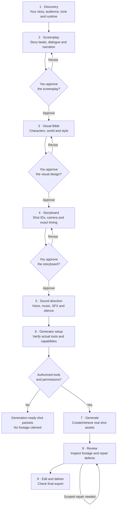
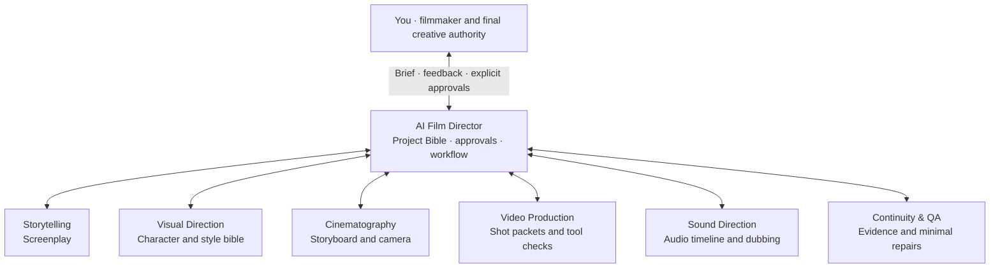

<div align="center">

# 🎬 Universal AI Film Director

**From a story idea to a professionally directed AI film — one creative partner, six specialized filmmaking skills.**

> **V2 status:** Public release-candidate preparation. See the [V2.0 release blockers and V2.1 roadmap](docs/v2-release-preflight.md). The Last Light V9 is a human-guided screening candidate, not proof of autonomous seven-agent production. Production GO remains HOLD for new provider jobs and final film release.

A portable, modular **Agent Skills** collection for writing screenplays, designing visual worlds, planning cinematic shots, directing sound, preparing generation prompts and reviewing film continuity.

[](https://github.com/montadhahri/universal-ai-film-director/releases/tag/v1.0.0)

[](https://github.com/montadhahri/universal-ai-film-director/actions/workflows/validate.yml)
[](https://github.com/montadhahri/universal-ai-film-director/actions/workflows/skills-install-smoke.yml)
[](LICENSE)


[**Quick start**](#-quick-start) · [**Installation**](#-installation) · [**Production workflow**](#-film-production-workflow) · [**Skills architecture**](#-how-the-skills-work-together) · [**Specialist skills**](#-meet-the-film-crew) · [**Compatibility**](#-agent-compatibility) · [**Releases**](#-versions--releases) · [**FAQ**](#-faq)

</div>

---

## ✨ What can you make?

Bring your own story, or start with a single sentence. Universal AI Film Director guides you through the creative process without requiring you to understand prompt engineering or filmmaking terminology.

- **Tell your story:** develop a premise, screenplay and optional dialogue or voice-over.
- **Give it a look:** create a Visual Bible defining characters, locations, art direction and visual continuity.
- **Direct the camera:** build a timed storyboard with framing, blocking, lighting, movement and transitions.
- **Design the sound:** plan narration, music, effects, dubbing and meaningful silence against the picture timeline.
- **Prepare video production:** receive copy-ready, shot-specific prompts adapted to the capabilities of your available tools.
- **Review and refine:** diagnose continuity or sound problems and propose targeted repairs without unnecessarily changing approved shots.

**You are the creative owner.** The AI Director offers informed recommendations, coordinates the workflow and tracks decisions. You approve the screenplay, Visual Bible, storyboard and any changes to protected work.

> **Important:** This is a filmmaking **direction and production-planning skill**, not a bundled video-rendering service. Actual images, voice, video clips or final MP4s require external tools that are genuinely available and authorized. The assistant must distinguish plans from generated or inspected media.

## 📊 Creative-quality benchmark (V1 vs V2)

An eight-scenario, blind model-reviewed comparison of original **textual filmmaking plans** is structurally complete after versioned adjudication: **8/8 offline-validator PASS**. V2's descriptive mean was **4.83/5** versus **4.50/5** for historical V1 (four V2 wins, one V1 win, three ties). These small-sample reviewer scores are **not** proof of better rendered films, and validator PASS does not authenticate reviewer conduct. The evaluation also identified a Visual Direction continuity regression targeted for correction.

Read the [full results, methodology, caveats and follow-up findings](docs/quality-benchmark-results.md). Production GO remains **HOLD**.

## 🎞️ The Last Light — human-guided film case study

A **30-second, five-shot V9 screening candidate** documents an image-first filmmaking experiment taken through owner-operated Google Flow / Veo 3.1 Fast video generation, local assembly and an ambient soundtrack. The five reference keyframes were generated with ChatGPT. The film is a **human-guided case study**, not a verified autonomous seven-agent execution or final creative/publication approval.

[Read the production case study, V9 technical evidence, approvals and remaining QA](docs/case-studies/the-last-light/README.md). See also the [AI media provider-terms review](docs/v2-ai-media-terms-review.md) and [media release-rights checklist](docs/v2-media-release-rights.md).

### Five-shot visual experiment

| SH01 · The dark town | SH03 · Carrying the spark | SH05 · The light returns |
| :---: | :---: | :---: |
| [](docs/case-studies/the-last-light/images/keyframes/SH01.png) | [](docs/case-studies/the-last-light/images/keyframes/SH03.png) | [](docs/case-studies/the-last-light/images/keyframes/SH05.png) |

*AI-assisted media disclosure: ChatGPT reference images, owner-operated Google Flow / Veo 3.1 Fast video shots and a locally assembled V9 cut. The production record describes locally created ambient audio; the original audio implementation has not been independently reconstructed.*

## 🚀 Quick start

**1. Install the Film Director.** With a [Skills CLI](https://skills.sh/)-compatible agent, install directly from GitHub — no clone needed:

```bash
npx skills add montadhahri/universal-ai-film-director --skill universal-ai-film-director
```

**2. Start a film.** In your agent, try:

> I want to create a 30-second cinematic animated film. A young girl finds the last spark of light in a city without a sun, carries it to an ancient tower, and releases it into the sky. Help me direct it, one step at a time.

The Director will use the details you've already supplied, ask **one focused question when needed**, offer professional creative suggestions, and ask for explicit approval at the key stages.

For agents without native skills support, provide the content of `skills/universal-ai-film-director/SKILL.md` and its relevant `references/` documents manually. See [installation options](docs/installation.md).

## 📦 Installation

The repository is currently private and undergoing public-release review. The commands below are written for the public version; until publication, repository access is required.

The repository contains **seven individually installable skill folders**. Install the Director for the complete guided experience; install specialists separately when your agent supports skill discovery.

| What you want | Install directly from GitHub |
| --- | --- |
| Full interactive filmmaking workflow | `npx skills add montadhahri/universal-ai-film-director --skill universal-ai-film-director` |
| Screenplay and narrative work | `npx skills add montadhahri/universal-ai-film-director --skill film-storytelling` |
| Characters, locations and art direction | `npx skills add montadhahri/universal-ai-film-director --skill film-visual-direction` |
| Camera direction and storyboards | `npx skills add montadhahri/universal-ai-film-director --skill film-cinematography` |
| Generator prompts and execution planning | `npx skills add montadhahri/universal-ai-film-director --skill film-video-production` |
| Narration, dubbing and music planning | `npx skills add montadhahri/universal-ai-film-director --skill film-sound-direction` |
| Continuity checks and repair proposals | `npx skills add montadhahri/universal-ai-film-director --skill film-continuity-qa` |

**Install all seven skills** in one command:

```bash
npx skills add montadhahri/universal-ai-film-director --skill '*'
```

**See available skills before installing:**

```bash
npx skills add montadhahri/universal-ai-film-director --list
```

**Installation note:** These GitHub commands are the supported Skills CLI syntax, but remote installation from this specific repository has not yet been independently tested. The repository is currently private; public visitors can use these commands once it is published. Until then, repository access is required. Installing a skill does not connect a video generator or spend credits.

For local development, cloning, offline installs, or checking out the historical `v1.0.0` tag, see [the installation guide](docs/installation.md).

[Installation details and troubleshooting](docs/installation.md)

## 🎞️ Film production workflow

The Director follows the same **nine-stage filmmaking journey** as the original single-skill release, now supported by six focused specialties. You start with an idea, collaborate on creative decisions and approve each major milestone.



**Approval gates are yours:** the AI does not automatically approve the screenplay, Visual Bible or storyboard. It may recommend camera, pacing or sound choices inside your approved direction. Generating video, connecting an account or spending credits requires separate permission and a genuinely available tool. If generation is unavailable, the deliverable is a **production plan**, not a finished film.

The Director keeps a **Project Bible** with the decisions, approved revisions, character and location anchors, shot IDs, continuity dependencies, audio cues and next safe step. You can resume from a checkpoint without restarting the story.

## 🧩 How the skills work together

The Director is your **creative partner and production coordinator**, not a replacement for you. Specialists contribute proposals; the Director reconciles them with your vision and presents approvals for you to decide.



**Two ways to use the skills:**

- **One agent:** install the Director and work through the entire film interactively. The Director can follow the specialist procedures in a single-agent workflow; native delegation is not required.
- **Modular skills:** install individual specialists for focused tasks. Where your agent supports skill discovery or delegation, the Director can coordinate their proposed outputs; exact cross-agent behavior depends on the host.

Each skill contains an entrypoint (`SKILL.md`), focused filmmaking references and reusable output templates. This helps keep prompts manageable while preserving detailed methods for camera continuity, generator capability checks, audio-only repairs and other demanding production tasks.

## 🎥 How filmmaking works

<details>
<summary><strong>See the full filmmaking process</strong></summary>

| Stage | What the AI helps create | Your role |
| --- | --- | --- |
| 1. Discovery | Creative brief: premise, audience, runtime, tone and constraints | Share your idea and preferences |
| 2. Story | Narrative beats, screenplay, optional voice-over | **Approve the screenplay** |
| 3. Visual direction | Visual Bible: character identity, worlds, palette and lighting | **Approve the Visual Bible** |
| 4. Cinematography | Timed storyboard, shot IDs, camera language and transitions | **Approve the storyboard** |
| 5. Sound | Narration, dubbing, effects, music and silence cue plan | Review and refine |
| 6. Video production | Generator-specific shot packets; real execution only if authorized tools exist | Authorize any external operations |
| 7. Review and delivery | Defect reports, targeted repairs and final-export checks | Approve changes and delivered results |

</details>

The Director records decisions in a **Project Bible** so the story, appearance, shot IDs and approved work stay consistent between stages. It also supports a copyable checkpoint for continuing in another chat or agent; a checkpoint is not a claim of automatic cloud storage.

### A real editing problem, handled carefully

You say:

> The narration disappears at second 18, but the picture is good. Don't change any of the approved video.

The Director and Sound/QA specialists should identify the affected audio cue, preserve the locked picture, ask for actual media or timecoded evidence if needed, and propose an **audio-only repair**. They must not claim the problem was fixed until a repaired export has actually been checked.

## 🎬 Meet the film crew

| Skill | Expertise |
| --- | --- |
| [**Director**](skills/universal-ai-film-director/SKILL.md) | Creative collaboration, approvals, project coordination and continuity |
| [**Storytelling**](skills/film-storytelling/SKILL.md) | Narrative structure, screenplay, dialogue and pacing |
| [**Visual Direction**](skills/film-visual-direction/SKILL.md) | Character/location bibles, artistic style and stable visual anchors |
| [**Cinematography**](skills/film-cinematography/SKILL.md) | Shot grammar, camera blocking, lighting, timing and storyboards |
| [**Video Production**](skills/film-video-production/SKILL.md) | Provider capability checks, shot packets and evidence-based generation planning |
| [**Sound Direction**](skills/film-sound-direction/SKILL.md) | Voice-over, dubbing, SFX, music, silence and synchronization |
| [**Continuity & QA**](skills/film-continuity-qa/SKILL.md) | Visual/audio review, defect triage and minimal repairs |

Each skill provides focused `SKILL.md` instructions, on-demand professional `references/` and output `assets/` where useful. You don't need to open every specialist manually for a normal film: the Director can manage the full process within **one agent**. Native multi-agent delegation is an optional integration, not a requirement.

## 🤖 Agent compatibility

The core is **plain Markdown Agent Skills instructions**, with no mandatory Codex-specific runtime, Python interpreter, external API key or special multi-agent framework.

| Environment | Intended approach | Verified scope |
| --- | --- | --- |
| Codex and compatible Skills CLI hosts | Install Director and optionally specialists | Local-folder CLI smoke install only; real-agent behavior not independently verified |
| Claude Code, Gemini CLI, Cursor and other compatible agents | Native skills if supported, or load Markdown manually | Compatibility depends on host/version; not certified |
| Custom agent workflows | Read skill files and references; optionally use shared contracts | Integration required; not independently tested |

Skills can guide a production on any compatible agent, but they **cannot guarantee identical automatic skill discovery**, external tool access or cross-agent delegation.

## 🏷️ Versions & releases

| Version | Meaning | Link |
| --- | --- | --- |
| **v1.0.0** | First tagged release; original single-skill system | [Release notes and source](https://github.com/montadhahri/universal-ai-film-director/releases/tag/v1.0.0) |
| **v2.0.0** | Modular Director and six specialists, in development | [Roadmap](docs/ROADMAP.md) · [Unreleased changes](CHANGELOG.md) |

Git tags preserve released versions. The working tree contains **one current source of truth**, not multiple runtime copies for each version. No v2 release tag is implied by its development status.

## ❓ FAQ

<details>
<summary><strong>Does the skill generate finished videos automatically?</strong></summary>

No. It creates structured film directions, prompts and review plans. Video/audio generation and assembly require actual tools and access. When these are unavailable, the agent must be transparent and report a planning-only or blocked state.

</details>

<details>
<summary><strong>Who decides the story and approves changes?</strong></summary>

You do. The Director proposes professional creative and technical choices, remembers your confirmed decisions in a Project Bible and asks for explicit approval at the screenplay, visual-bible and storyboard stages. Approved work stays protected.

</details>

<details>
<summary><strong>Can I use only one agent, rather than a multi-agent system?</strong></summary>

Yes. The Director can follow the full workflow sequentially with one capable agent. Separate specialists improve modular organization; native agent-to-agent delegation is not required.

</details>

<details>
<summary><strong>Will the skill use my private generator accounts or spend credits?</strong></summary>

Not by itself. Any provider account connection, asset upload, paid operation or publication requires an available integration and your separate authorization.

</details>

## 📚 Documentation

[Installation](docs/installation.md) · [Architecture](docs/architecture.md) · [Roadmap](docs/ROADMAP.md) · [Changelog](CHANGELOG.md) · [Contributing](CONTRIBUTING.md)

## 📜 License

[MIT License](LICENSE). Ensure that any film assets, recordings, voices and music used in your production are properly licensed or authorized.

---

<div align="center">

**Your story. Your vision. An AI film crew to bring the direction together.**

</div>
