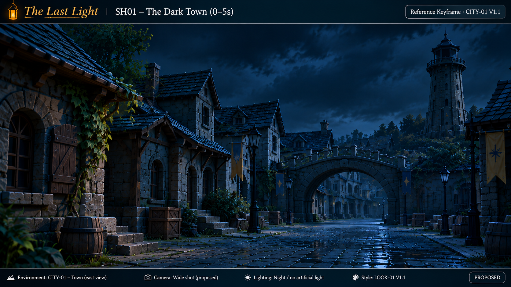
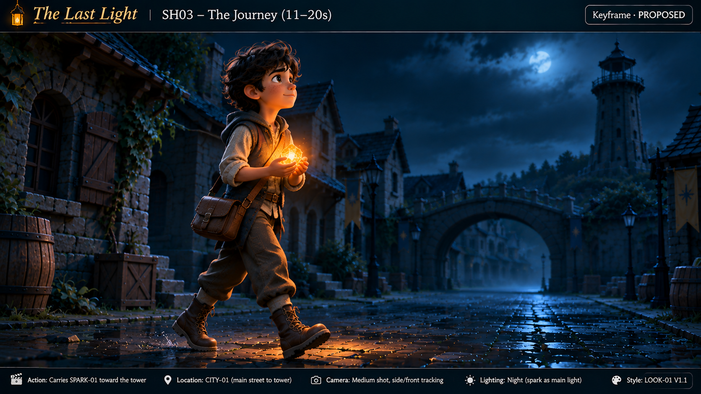
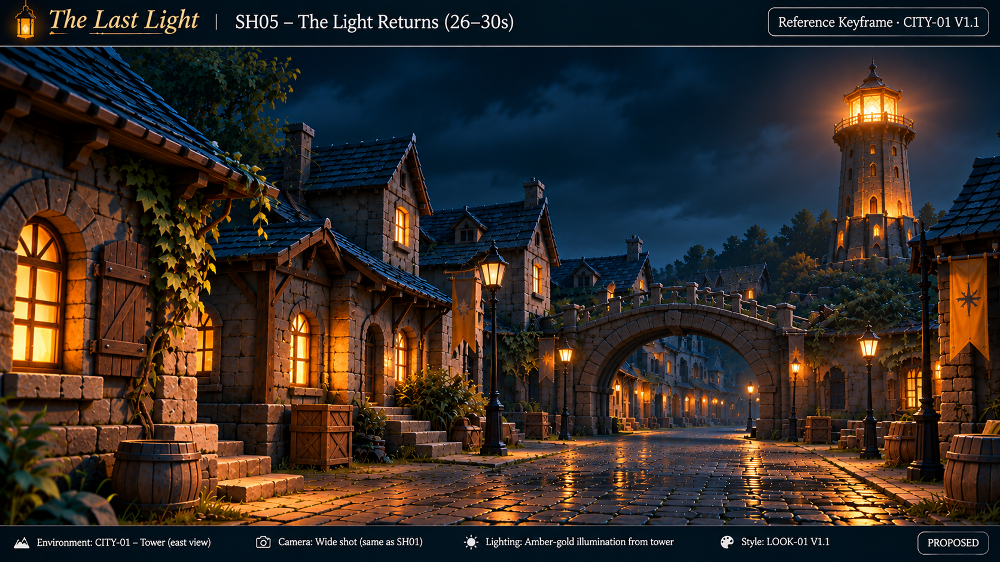
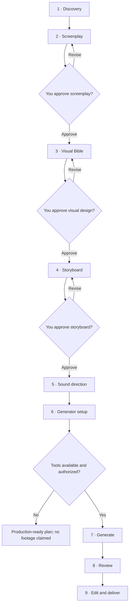

<div align="center">

# 🎬 Universal AI Film Director

**From one idea to a cinematic film production plan.**

An open-source AI filmmaking crew: one Director, six specialist skills, and **you in creative control**.

[](https://github.com/montadhahri/universal-ai-film-director/releases/tag/v2.0.0)
[](docs/ROADMAP.md)
[](https://github.com/montadhahri/universal-ai-film-director/actions/workflows/validate.yml)
[](https://github.com/montadhahri/universal-ai-film-director/actions/workflows/skills-install-smoke.yml)
[](LICENSE)

[Quick start](#-get-started) · [Example](#-see-it-in-action) · [Workflow](#-film-production-workflow) · [Skills](#-meet-your-ai-film-crew) · [Architecture](#-skills-architecture) · [Compatibility](#-agent-compatibility) · [Releases](#-releases-and-roadmap) · [FAQ](#-faq)

</div>

## ✨ What can you create?

Turn a short idea into a **screenplay, visual style guide, timed storyboard, sound plan, and generation-ready shot prompts**. The Director helps you make creative decisions, keeps characters and shots consistent, and proposes targeted fixes when something goes wrong.

- **Create:** animated shorts, personal stories, cinematic scenes, and advertisements.
- **Direct:** framing, pacing, character continuity, lighting, narration, and sound.
- **Stay in control:** approve the screenplay, visual design, and storyboard before moving forward.
- **Work with your tools:** plan a film even without access to paid image or video generators.

This is a **direction and production-planning system**, not a bundled video-rendering service. Actual media generation requires separately available tools and your authorization.

## 🎞️ See it in action

**The Last Light** — a human-guided, 30-second, five-shot filmmaking experiment about restoring light to a dark town.

| The dark town | Carrying the spark | The light returns |
| :---: | :---: | :---: |
| [](docs/case-studies/the-last-light/images/keyframes/SH01.png) | [](docs/case-studies/the-last-light/images/keyframes/SH03.png) | [](docs/case-studies/the-last-light/images/keyframes/SH05.png) |

These are AI-generated reference images, **not proof of autonomous end-to-end production**. The historical V9 cut was assembled with human-operated tools; its MP4 is excluded from the current release tree pending separate media-rights clearance.

[Explore the full case study](docs/case-studies/the-last-light/README.md) · [Media terms](docs/case-studies/the-last-light/MEDIA-TERMS.md)

## 🚀 Get started

**1. Install the Director** using the [Skills CLI](https://skills.sh/) in a compatible agent environment:

```bash
npx skills add montadhahri/universal-ai-film-director --skill universal-ai-film-director
```

**2. Open your agent and try this prompt:**

> Help me direct a 30-second animated film about a child who finds the last spark of light in a dark city. Guide me step by step. Do not generate media yet.

**3. Shape the film together.** The Director asks focused questions, proposes a creative direction, and requests your approval at important milestones. Your first result is a **plan**, not an automatically rendered video.

Want to install every specialist? Run:

```bash
npx skills add montadhahri/universal-ai-film-director --skill '*'
```

On **Windows CMD**, use `--skill "*"` instead. For individual skills, local installation, and troubleshooting, see the [installation guide](docs/installation.md).

## 🆕 V2.1.0 release candidate

**Install and start directing with more confidence.** V2.1.0 improves first-use instructions and documents verified, owner-operated skill loading in **Codex and OpenCode**. All seven skills passed the pinned public Skills CLI installation smoke test; a scoped 30-second film-planning scenario loaded the Director and two specialists in each tested host, producing approval-safe proposals.

- **Codex:** successful `SKILL.md` and reference file reads; no separate native skill-tool invocation was shown in the reviewed session.
- **OpenCode:** three native `skill` calls plus reference reads in the reviewed session.
- **Evidence boundary:** sessions were owner-operated and independently reviewed, not independently executed. Exact installed Git revisions, unfamiliar-user onboarding, and native Director-to-specialist delegation remain unverified.

**Release status:** V2.1.0 is approved for release preparation but is **not published until its Git tag and GitHub release exist**. The stable badge above remains on v2.0.0 until then. [Full compatibility evidence](docs/installation.md#complete-targeted-host-transcript-review-2026-11-07).

## 🎬 Meet your AI film crew

| Skill | What it helps you do |
| --- | --- |
| [**Director**](skills/universal-ai-film-director/SKILL.md) | Guide the project, coordinate decisions, and track approvals |
| [**Storytelling**](skills/film-storytelling/SKILL.md) | Develop stories, screenplays, dialogue, and pacing |
| [**Visual Direction**](skills/film-visual-direction/SKILL.md) | Define characters, locations, visual identity, and continuity |
| [**Cinematography**](skills/film-cinematography/SKILL.md) | Plan shots, camera movement, lighting, and timing |
| [**Video Production**](skills/film-video-production/SKILL.md) | Prepare generation prompts and check tool capabilities |
| [**Sound Direction**](skills/film-sound-direction/SKILL.md) | Plan voice-over, music, effects, and synchronization |
| [**Continuity & QA**](skills/film-continuity-qa/SKILL.md) | Identify defects and propose focused repairs |

## 🎞️ Film production workflow

The Director follows a **nine-stage filmmaking journey**. The milestones are creative decisions, not automatic permission to generate media. You approve the screenplay, Visual Bible and storyboard before dependent work advances.



**The Project Bible** tracks approved revisions, character and location anchors, shot IDs, continuity decisions, unresolved issues and the next safe step. A copyable checkpoint helps resume a project in another chat or agent; it is not automatic cloud storage. External generation, account connections, spending and publication **require separate authorization**.

## 🧩 Skills architecture

**You remain the final creative authority.** The Director coordinates the six specialist disciplines, checks their proposals against approved work, and presents decisions for your review. Specialists do not independently approve or override locked shots.

- **One-agent mode:** install the Director and work through the whole process in one compatible agent. Native multi-agent delegation is not required.
- **Modular mode:** install individual specialists for focused work. Agent-native discovery and delegation depend on the host and are not universally verified.

Each skill has a `SKILL.md` entrypoint and task-specific references. The [architecture guide](docs/architecture.md) explains the contracts, handoffs and project state in detail.

## 🛠️ Real-world use cases

**Start from an idea:** “Make a 30-second animated short about a child carrying light to a tower.” The Director helps shape the story, style, timed shots and sound plan, requesting approval before progressing.

**Repair without breaking approved work:** “The narration disappears at second 18, but the picture is good. Don't change the video.” Sound Direction and Continuity & QA should propose a scoped **audio-only repair**, preserving locked picture. They must not claim a successful fix without inspecting the repaired output.

## 🤖 Agent compatibility

The skills use portable Markdown instructions; **no Python runtime or generator API key is required to install them**.

| Environment | Current evidence |
| --- | --- |
| **Codex (Windows)** | **Targeted PASS (2026-11-07):** exported session independently reviewed; Director, Storytelling and Visual Direction `SKILL.md` files loaded via filesystem reads, references consulted and approval-safe 30-second proposal produced. No separate skill-tool call in this host trace. |
| **OpenCode (Windows)** | **Targeted PASS (2026-11-07):** exported session independently reviewed; native `skill` tool loaded Director, Storytelling and Visual Direction, two references read and approval-safe 30-second proposal produced. |
| **Gemini CLI** | Authentication blocked in owner's test; skill invocation **not tested** |
| **Claude Code, Cursor, other agents** | Intended for compatible skills hosts; native invocation **not independently verified** |

Public GitHub installation of all seven skills also [passed a pinned CI smoke test](https://github.com/montadhahri/universal-ai-film-director/actions/runs/41921930247). The 2026-11-07 Codex and OpenCode owner-operated session exports were independently reviewed for the targeted planning task. Exact installed Git source revision, independent clean-user onboarding and native Director-to-specialist delegation remain **not verified**; do not generalize these scoped results to every agent.

[See exact host-test evidence and reproduce the checks](docs/installation.md)

## 📊 Quality and validation

An eight-scenario comparison of **textual film plans** reported a descriptive mean of **4.83/5 for V2**, versus **4.50/5 for historical V1**, with 8/8 offline-validator passes. This small evaluation is **not evidence of better rendered films**, independent host execution, or autonomous seven-agent production. [Read the methodology and caveats](docs/quality-benchmark-results.md).

CI validates repository structure and skills, while a [pinned public-GitHub installation smoke test](https://github.com/montadhahri/universal-ai-film-director/actions/runs/41921930247) verified CLI installation, **not live host invocation**. See [host-test evidence](docs/installation.md) for current limits.

## 🏷️ Releases and roadmap

| Version | Status | Focus |
| --- | --- | --- |
| [v1.0.0](https://github.com/montadhahri/universal-ai-film-director/releases/tag/v1.0.0) | Released | Original single-skill Director |
| [v2.0.0](https://github.com/montadhahri/universal-ai-film-director/releases/tag/v2.0.0) | **Latest stable release** | Director and six specialist skills |
| **v2.1.0** | **Release-ready; publication pending** | Public Skills CLI installation, targeted Codex/OpenCode skill-use evidence, and beginner guidance; independent-user and delegation limits disclosed |
| **V3** | Research only on `develop` | Experimental connected-agent production ideas; not part of the V2.x release |

The [canonical roadmap](docs/ROADMAP.md) defines proposed milestones and acceptance gates; it does not authorize release or provider spending. **Production GO remains HOLD.** Published releases remain identifiable by their tags; `main` is the V2.x integration branch, not a guarantee that every commit is a tagged release. See [CHANGELOG](CHANGELOG.md).

## 🤝 Development and contributing

Contributions, issue reports and reproducible host-testing results are welcome. Start with [CONTRIBUTING.md](CONTRIBUTING.md) and the [development guidelines](docs/DEVELOPMENT.md).

V2.x work is proposed by PR to `main`; V3 research is proposed to `develop`. A `main` → `develop` synchronization PR requires review and **does not auto-merge**. Keep changes focused, preserve approvals and evidence, and run applicable checks. The repository's documentation favors a small number of canonical guides over duplicate reports.

## ❓ FAQ

**Does this create a finished video automatically?** No. It directs and plans filmmaking; actual image, audio and video generation needs genuinely available tools and separate permission.

**Do I need a paid AI video subscription or an API key?** No for planning or installation. Rendering may require other tools, which the Director must check before proposing execution.

**Can I use only one AI agent?** Yes. The Director can follow the specialist methods within one agent. Native multi-agent delegation is optional and host-dependent.

**Can I install only a specialist?** Yes. See the [installation guide](docs/installation.md) for each skill's command and supported installation options.

**Can I continue a film later or fix only one shot?** The Project Bible and copyable checkpoints help resume work; locked decisions remain protected. A repair is proposed and reviewed before any approved asset changes.

## 📚 Learn more

[Installation and troubleshooting](docs/installation.md) · [Architecture](docs/architecture.md) · [Roadmap](docs/ROADMAP.md) · [Changelog](CHANGELOG.md) · [Contributing](CONTRIBUTING.md) · [Development guidelines](docs/DEVELOPMENT.md)

### License and media rights

The software, Agent Skills, templates, and written documentation are licensed under [MIT](LICENSE). **The Last Light images and historical video are not MIT-licensed**; see their [separate media terms](docs/case-studies/the-last-light/MEDIA-TERMS.md) and [rights checklist](docs/security/v2-media-release-rights.md). The V9 MP4 is not part of the current release tree, and historical Git availability does not grant reuse rights.

This is an independent personal project, not affiliated with or endorsed by the author's employer or any AI service provider. The project owner reports that no employer source code, internal materials, or resources were used.

---

<div align="center">

**Your story. Your vision. Your AI film crew.**

</div>
