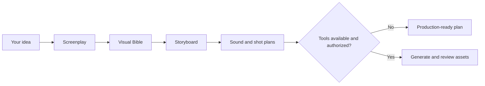

<div align="center">

# 🎬 Universal AI Film Director

**From one idea to a cinematic film production plan.**

An open-source AI filmmaking crew: one Director, six specialist skills, and **you in creative control**.

[](https://github.com/montadhahri/universal-ai-film-director/releases/tag/v2.0.0)
[](docs/ROADMAP.md)
[](https://github.com/montadhahri/universal-ai-film-director/actions/workflows/validate.yml)
[](https://github.com/montadhahri/universal-ai-film-director/actions/workflows/skills-install-smoke.yml)
[](LICENSE)

[Get started](#-get-started) · [Example](#-see-it-in-action) · [Skills](#-meet-your-ai-film-crew) · [Compatibility](#-agent-compatibility) · [Documentation](#-learn-more)

</div>

## ✨ What can you create?

Turn a short idea into a **screenplay, visual style guide, timed storyboard, sound plan, and generation-ready shot prompts**. The Director helps you make creative decisions, keeps characters and shots consistent, and proposes targeted fixes when something goes wrong.

- **Create:** animated shorts, personal stories, cinematic scenes, and advertisements.
- **Direct:** framing, pacing, character continuity, lighting, narration, and sound.
- **Stay in control:** approve the screenplay, visual design, and storyboard before moving forward.
- **Work with your tools:** plan a film even without access to paid image or video generators.

This is a **direction and production-planning system**, not a bundled video-rendering service. Actual media generation requires separately available tools and your authorization.

## 🎞️ See it in action

**The Last Light** — a human-guided, 30-second, five-shot filmmaking experiment about restoring light to a dark town.

| The dark town | Carrying the spark | The light returns |
| :---: | :---: | :---: |
| [](docs/case-studies/the-last-light/images/keyframes/SH01.png) | [](docs/case-studies/the-last-light/images/keyframes/SH03.png) | [](docs/case-studies/the-last-light/images/keyframes/SH05.png) |

These are AI-generated reference images, **not proof of autonomous end-to-end production**. The historical V9 cut was assembled with human-operated tools; its MP4 is excluded from the current release tree pending separate media-rights clearance.

[Explore the full case study](docs/case-studies/the-last-light/README.md) · [Media terms](docs/case-studies/the-last-light/MEDIA-TERMS.md)

## 🚀 Get started

**1. Install the Director** using the [Skills CLI](https://skills.sh/) in a compatible agent environment:

```bash
npx skills add montadhahri/universal-ai-film-director --skill universal-ai-film-director
```

**2. Open your agent and try this prompt:**

> Help me direct a 30-second animated film about a child who finds the last spark of light in a dark city. Guide me step by step. Do not generate media yet.

**3. Shape the film together.** The Director asks focused questions, proposes a creative direction, and requests your approval at important milestones. Your first result is a **plan**, not an automatically rendered video.

Want to install every specialist? Run:

```bash
npx skills add montadhahri/universal-ai-film-director --skill '*'
```

On **Windows CMD**, use `--skill "*"` instead. For individual skills, local installation, and troubleshooting, see the [installation guide](docs/installation.md).

## 🎬 Meet your AI film crew

| Skill | What it helps you do |
| --- | --- |
| [**Director**](skills/universal-ai-film-director/SKILL.md) | Guide the project, coordinate decisions, and track approvals |
| [**Storytelling**](skills/film-storytelling/SKILL.md) | Develop stories, screenplays, dialogue, and pacing |
| [**Visual Direction**](skills/film-visual-direction/SKILL.md) | Define characters, locations, visual identity, and continuity |
| [**Cinematography**](skills/film-cinematography/SKILL.md) | Plan shots, camera movement, lighting, and timing |
| [**Video Production**](skills/film-video-production/SKILL.md) | Prepare generation prompts and check tool capabilities |
| [**Sound Direction**](skills/film-sound-direction/SKILL.md) | Plan voice-over, music, effects, and synchronization |
| [**Continuity & QA**](skills/film-continuity-qa/SKILL.md) | Identify defects and propose focused repairs |

**Use one agent or individual specialists.** The Director can guide the full process in a single agent; native multi-agent delegation is optional and depends on the host.

### The filmmaking journey



You approve the screenplay, Visual Bible, and storyboard. A **Project Bible** records approved decisions, character references, and shot IDs so work can continue consistently. Generation, account connections, and spending require separate authorization.

## 🤖 Agent compatibility

The skills use portable Markdown instructions; **no Python runtime or generator API key is required to install them**.

| Environment | Current evidence |
| --- | --- |
| **Codex (Windows CMD)** | **Partial pass:** owner-operated native invocation of Director, Storytelling, and Visual Direction, with installed `SKILL.md` reads (November 5, 2026) |
| **OpenCode** | Model connection tested; skill installation and invocation **not tested** |
| **Gemini CLI** | Authentication blocked in owner's test; skill invocation **not tested** |
| **Claude Code, Cursor, other agents** | Intended for compatible skills hosts; native invocation **not independently verified** |

Public GitHub installation of all seven skills also [passed a pinned CI smoke test](https://github.com/montadhahri/universal-ai-film-director/actions/runs/41921930247). Codex observations are owner-reported, not independently archived complete transcripts; cross-host portability and Director-to-specialist delegation are **not yet certified**.

[See exact host-test evidence and reproduce the checks](docs/installation.md)

## 📊 Quality and development

In an eight-scenario comparison of **textual film plans**, V2 scored a descriptive mean of **4.83/5**, versus **4.50/5** for historical V1. The offline validator passed 8/8 scenarios. This small evaluation **does not establish better rendered films** or independent agent performance.

[Benchmark methodology and caveats](docs/quality-benchmark-results.md) · [V2.1 roadmap](docs/ROADMAP.md)

**Releases:** [v2.0.0](https://github.com/montadhahri/universal-ai-film-director/releases/tag/v2.0.0) is the latest stable version. **V2.1.0 is actively in development**, with partial owner-operated Codex testing completed and broader host verification still pending. It has not been released; production GO remains **HOLD**.

## 📚 Learn more

[Installation and troubleshooting](docs/installation.md) · [Architecture](docs/architecture.md) · [Roadmap](docs/ROADMAP.md) · [Changelog](CHANGELOG.md) · [Contributing](CONTRIBUTING.md) · [Development guidelines](docs/DEVELOPMENT.md)

### License and media rights

The software, Agent Skills, templates, and written documentation are licensed under [MIT](LICENSE). **The Last Light images and historical video are not MIT-licensed**; see their [separate media terms](docs/case-studies/the-last-light/MEDIA-TERMS.md) and [rights checklist](docs/security/v2-media-release-rights.md). The V9 MP4 is not part of the current release tree, and historical Git availability does not grant reuse rights.

This is an independent personal project, not affiliated with or endorsed by the author's employer or any AI service provider. The project owner reports that no employer source code, internal materials, or resources were used.

---

<div align="center">

**Your story. Your vision. Your AI film crew.**

</div>
