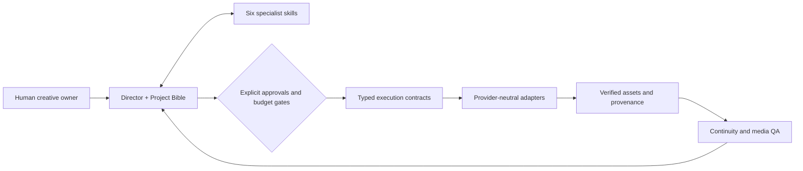

# Product roadmap — Universal AI Film Director

**Canonical version and milestone roadmap · reconciled 2026-11-04.** This document is the single source for planned scope, priority, phase exit gates and release readiness. GitHub issues/PRs/CI provide live execution evidence. [Development governance](DEVELOPMENT.md) covers GitFlow and release operations; [release preflight](releases/v2.0.0-checklist.md) contains the detailed V2 release checklist. Historical operational context and release evidence remain in Git history and the linked supporting reports.

> **Current decision:** V1.0.0 is the last published release. V2.0.0 is **unreleased**, despite public repository visibility and substantial implemented V2 work. **Production GO: HOLD**. No release, provider job, credit spend, account connection, media publication, or branch deletion is authorized by this roadmap. Statements below distinguish repository implementation, observed evidence and unverified acceptance.

## At a glance

| Version | Outcome | Status | Next decision |
| --- | --- | --- | --- |
| **V1.0.0** | Original Film Director skill | **RELEASED** — [historical tag](https://github.com/montadhahri/universal-ai-film-director/releases/tag/v1.0.0) | Preserve history |
| **V2.0.0** | Director + six specialist skills, contracts, tests, deterministic recovery and human-guided film case study | **IMPLEMENTED / RELEASE BLOCKED** | Close release-critical privacy, rights and reproducibility gates; explicit owner release decision |
| **V2.1.0** | Verified portability, independent agent handoffs, stronger approval provenance and media QA | **PROPOSED** — scope not frozen | Validate V2.0 baseline, prioritize measurable gaps |
| **V3.x** | Provider-neutral agentic filmmaking execution | **RESEARCH ONLY** | Feasibility, terms, budget, security and no-cost prototype before implementation |

### Status vocabulary

**RELEASED** means a published tagged version. **IMPLEMENTED** means code or documentation exists; it is not acceptance proof. **EVIDENCED** means a documented test/case study supports a limited claim. **PARTIAL** means a gate is incomplete. **BLOCKED** means a required condition is unresolved. **PROPOSED** and **RESEARCH** are not commitments. Use PASS/FAIL/BLOCKED/NOT_RUN/NOT_VERIFIED for individual test results.

## Current evidence and limitations

| Capability | Evidence | Unresolved limitation |
| --- | --- | --- |
| Seven-skill architecture and Project Bible | Repository skill files and stage-gate contracts | Native cross-host invocation and autonomous delegation not proven |
| Specialist and Director acceptance | Planning-only tests and targeted regressions | No independent seven-agent real-media end-to-end acceptance |
| Creative benchmark | [Eight adjudicated V1/V2 textual comparisons](quality-benchmark-results.md), descriptive means 4.50 vs 4.83 / 5 | Small model-reviewed sample; not proof of better rendered films |
| Recovery | [Phase 7 exit assessment](phase7-recovery-exit.md), offline deterministic and fresh-process tests | Trusted approval provenance, asset integrity and cross-host recovery open |
| Real-media pilot | [The Last Light V9](case-studies/the-last-light/README.md): human-guided five-shot screening candidate | Independent visual/audio QA, rights and final publication approval open |
| Public install | [V2 release preflight](releases/v2.0.0-checklist.md) records clean GitHub-source CI install | Two-host interactive skill invocation remains unverified |
| Security and rights | [Public-exposure audit](security/v2-public-exposure-audit.md), [rights checklist](security/v2-media-release-rights.md), [terms review](archive/v2/v2-ai-media-terms-review.md) | Full reachable-history/privacy/binary audit not independently complete; soundtrack origin UNKNOWN / NOT_VERIFIED |

## V2.0.0 — release-critical track

**Scope:** seven portable skills; Director-specialist planning contracts; separate creative and execution approval gates; deterministic checkpoint/recovery tooling; reproducible tests; accurate, clearly labeled human-operated V9 case study. Do not broaden V2.0 to autonomous provider execution.

| ID | Workstream | Current state | Exit evidence / next action |
| --- | --- | --- | --- |
| V2-R1 | Seven-skill architecture and stage gates | **IMPLEMENTED** | Preserve contract and test provenance; no autonomous claim |
| V2-R2 | Benchmark and targeted regressions | **EVIDENCED, scoped** | Retain historical reviews and unresolved regression findings |
| V2-R3 | Offline recovery and checkpoint format | **EVIDENCED, scoped** | Document limits; cross-host/trusted approvals deferred to V2.1 |
| V2-R4 | Human-guided The Last Light V9 example | **SCREENING CANDIDATE** | Preserve actual media provenance and unresolved QA; no final film acceptance claim |
| V2-R5 | Public install and packaging | **CI EVIDENCE EXISTS** | Verify intended release commit and public install reproducibility |
| V2-R6 | Public history, privacy, secrets, dependencies | **BLOCKED / INCOMPLETE** | Audit reachable refs/history, binary omissions, alerts and licenses; redact findings |
| V2-R7 | Media rights and attribution | **BLOCKED / INCOMPLETE** | Establish soundtrack provenance and rights for every distributed asset; unknown stays unknown |
| V2-R8 | Release documentation, CI and owner approval | **OPEN** | Align README, notes, changelog, exact SHA, checks; explicit release authorization |

**V2.0 release gate:** V2-R6, R7 and R8 must be resolved or explicitly scoped with documented lawful/safe exclusions; final CI and packaging checks must apply to the actual release SHA. A repository being public, an earlier green scan or a merged PR is not a release approval. Detailed checklist: [V2 release preflight](releases/v2.0.0-checklist.md).

## V2.1.0 — candidate capability milestones

These are **not automatically V2.0 blockers**. Prioritize after a V2.0 release decision and evidence review.

| ID | Milestone | Acceptance target | Dependency |
| --- | --- | --- | --- |
| V21-1 | Two-host skill portability | Clean pinned install and actual Director + two specialist invocation logs in two supported hosts; distinguish native invocation from pasted instructions | V2 packaging |
| V21-2 | Director/specialist orchestration | Independent text-only end-to-end scenario with preserved handoffs, real approval gates and no fabricated media | V21-1 |
| V21-3 | Trusted recovery | Cross-host checkpoint transfer with revision, approval-source, locked-asset and missing-data checks | V21-1, existing recovery |
| V21-4 | Image/prop continuity | Independent SH01–SH05 keyframe comparison for CHILD-01, SPARK-01, TOWER-01, wardrobe, lighting and geography | Existing case-study assets |
| V21-5 | Localized video repair | Demonstrate before/after scoped repair without changing locked shots; preserve exact artifact evidence | V21-4 |
| V21-6 | Sound/export QA | Inspect V9 shot transitions, fade, timing and actual soundtrack/listening result; report unresolved defects | Rights review, existing V9 |
| V21-7 | Quality and portability regressions | Evidence-backed cross-stage tests, stable compatibility and truthful PASS/FAIL/NOT_RUN reports | V21-2–6 |

**Candidate scope is subject to revision**; no automatic generation or new provider integration is authorized.

## V3 — connected agentic filmmaking research

**Product hypothesis:** the Director remains the creative orchestrator and six specialist skills remain the decision layer, while an execution layer connects authorized providers and local tools. The aim is traceable, recoverable, approval-gated production rather than simply generating more prompts.

| Research stage | Proposed outcome | Go/no-go evidence |
| --- | --- | --- |
| V3-R1 — Feasibility | Provider/API/terms matrix; identify supported image, video, speech, music and editing integrations | Documented legitimate API availability, licensing, privacy and cost model; never assume website automation is permitted |
| V3-R2 — Architecture | Typed job, artifact, checkpoint, retry, budget and approval contracts | Threat model, state machine, provider-neutral design review |
| V3-R3 — Local no-cost prototype | Mock provider jobs + optional FFmpeg assembly on existing authorized assets | Deterministic test results; no paid calls or external account connection |
| V3-R4 — First authorized adapter | One real integration only after explicit permission | Scoped account/credit authorization, cost ceiling, provenance and rollback |
| V3-R5 — Coordinated production pilot | Multi-agent orchestration with evidence-based visual/audio QA and resumability | Actual inspected output and honest failure metrics, not simulated PASS |

**Not committed:** provider choices, availability of Google Flow APIs, autonomous generation, additional agents, dates, spend or release versions. Any provider call, credit spend, account connection or media publication requires its own explicit approval.

## Cross-version execution order

1. **Now — documentation and audit:** review this canonical roadmap, [development governance](DEVELOPMENT.md) and historical evidence; close documentation inconsistencies by PR. No release or branch migration implied.
2. **V2 release safety:** investigate privacy/history/binaries and media rights first. Do not run the historical-path inventory workflow until its raw artifact-upload exposure is reviewed.
3. **V2 acceptance:** validate remaining package/CI and honest release documentation; obtain explicit owner decision before publishing a V2 tag or release.
4. **V2.1 evidence:** execute independent host invocation, trusted recovery, continuity and scoped repair tests without assuming external paid generation.
5. **V3 feasibility:** perform research and local/mock prototypes before requesting provider integrations.

## Repository governance migration — separate approval track

Target [simplified GitFlow](DEVELOPMENT.md): permanent `main` (released stable) and `develop` (next version); PR-only short-lived work branches; `release/x.y.z` stabilization and `hotfix/*` backports; immutable version tags.

**Important:** `main` currently contains unreleased V2 work. Do **not** reset/force-push history, pretend `main` is V1, or create a V2 tag as a shortcut.

| Step | State | Safety condition |
| --- | --- | --- |
| G1. Document workflow and inspect current refs/PRs | **DOCUMENTATION PROPOSED** | Preserve historical PRs, V1 tag and unique commits |
| G2. Decide V2-in-main migration path | **NOT STARTED** | Owner approves migration after comparison and impact analysis |
| G3. Create `develop`; protect it and `main` from deletion | **NOT STARTED** | Verify rulesets/plan actually enforce deletion protection |
| G4. Enable auto-delete of merged PR heads | **OFF / NOT VERIFIED** | Only after G3; source branch `develop` must be protected |
| G5. Inventory ~117 reported legacy branches | **NOT AUDITED** | Review merged/open-PR/unique commits; never bulk-delete blindly |
| G6. Clean obsolete branches | **NOT AUTHORIZED** | Separate owner approval and verified recoverability |

See [DEVELOPMENT.md](DEVELOPMENT.md) for detailed release/hotfix/branch rules. The number of branches is a previously reported estimate, not a verified live count.

## Historical phase-to-milestone mapping

The original numbered V2 phases are preserved here as a traceability index, not a second active plan.

| Historical phase | Current milestone | Evidence/remaining gap |
| --- | --- | --- |
| 1 — Architecture | V2-R1 | Seven skills implemented |
| 2 — Specialist/Director tests | V2-R2 | Planning-only acceptance |
| 3–4 — Creative benchmark and fixes | V2-R2, V21-7 | [Benchmark](quality-benchmark-results.md), PR #62/#63 and follow-up regressions |
| 5 — Five-keyframe pilot | V2-R4, V21-4 | [V9 case study](case-studies/the-last-light/README.md); independent acceptance open |
| 6 — Localized repair | V21-5 | Human-guided repair exists; independent locked-asset verdict open |
| 7 — Recovery | V2-R3, V21-3 | [Offline recovery](phase7-recovery-exit.md) evidenced; trusted/cross-host partial |
| 8 — Video/sound/export | V2-R4, V21-6 | V9 screening candidate; final QA/rights open |
| 9 — Portability/security/release | V2-R5–R8, V21-1–2 | Public install CI evidenced; release gates open |

## Evidence and change-control rules

- Every milestone closure links an exact PR/commit, test output or inspectable media result; historical reports stay intact.
- No invented approvals, generated footage, independent reviewer actions, media inspection or host invocation.
- A merged PR, a CI PASS, a model-reviewed text benchmark, a rendered MP4 and a release authorization are distinct evidence classes.
- For new work, use scoped branches and PRs; no direct protected-branch changes. The GitFlow migration itself requires separate review.
- Update **this roadmap** when version scope or milestone state changes; keep Git history for former operational snapshots and release preflight as a gate checklist, not parallel progress plans.
