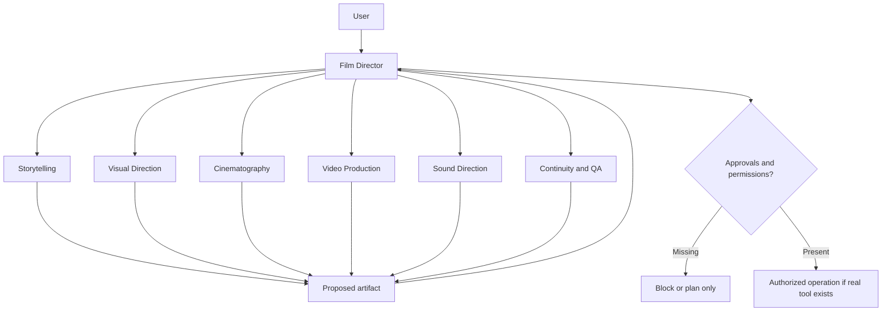

# Architecture — modular filmmaking skills

## Principles

- **Agent-neutral Agent Skills:** each `skills/<name>/SKILL.md` uses a clear `name`/`description` frontmatter, task-specific instructions and on-demand local references.
- **One Director:** `universal-ai-film-director` owns user-visible approval gates, Project Bible, shot locking, and final actions. No specialist can infer approvals or mutate the canonical state by itself.
- **Six specialists:** story, visual direction, cinematography, video production, sound direction, continuity/QA. Every specialist returns scoped proposed work and dependencies, not autonomous decisions.
- **Portable single-agent mode:** the Director can perform all stages sequentially. Agent-to-agent delegation is an optional host feature and is never presumed to exist.
- **Evidence before claims:** PLANNED prompts and synthetic tests do not mean footage exists. Record actual provider/job/asset information only when observed.
- **Permission separations:** screenplay approval, permission to spend/generate, release publication, and rights consent are distinct.
- **Locked continuity:** preserving an old approved revision is mandatory in a repair; a new proposal requires scope-specific authorization.



## Source layout

```text
skills/                         # seven portable installable skills, one source of truth
  universal-ai-film-director/
    SKILL.md
    references/guide.md
  film-storytelling/
  film-visual-direction/
  film-cinematography/
  film-video-production/
  film-sound-direction/
  film-continuity-qa/
contracts/                      # shared current contracts, version-neutral paths
scripts/                        # optional deterministic Node.js utilities
tests/                          # offline validation and regression evidence
docs/                           # current architecture, roadmap, installation
```

Do not keep a duplicate root `SKILL.md` or mirror runtime files under root `engine/`, `adapters/`, `references/`, `schemas/`, `templates/`. Historic content is in [v1.0.0](https://github.com/montadhahri/universal-ai-film-director/releases/tag/v1.0.0).

## Handoff and project state

The Director uses canonical `contracts/project-bible.schema.json` and specialist `contracts/handoff.schema.json` when machine-readable state is useful. Both are repository authoring contracts, **not guaranteed to be installed alongside individual skills**. Each `SKILL.md` also explains the essential contract so it can work as a standalone portable instruction.

Specialist replies reference the current `project_id`, `input_revision`, request ID and PROPOSED artifact; the Director rejects stale proposals and keeps approval, locked shot and provider permission ledgers separate. Tests cannot prove a model followed instructions; agent acceptance requires real transcripts.

## V2.2 Director-to-specialist handoff sequence

1. Director reads the canonical Project Bible and chooses the specialist for the next unfinished planning stage: storytelling for script; visual direction for Visual Bible; cinematography for storyboard; sound direction for audio plan; video production for generator-ready shot packets; continuity QA for document/media-evidence review. Specialists may be consulted again for scoped revisions.
2. Director supplies the project ID, current revision, relevant approved artifact versions, constraints, continuity anchors, request ID, and exact requested output. Missing approvals remain missing; they are not assumed.
3. Specialist returns a `PROPOSED` handoff using `contracts/handoff.schema.json`, including `stage`, `origin`, `input_revision`, `proposed_artifact`, `provenance` and `required_authorization`. An agent draft is not an approved or rendered asset.
4. Director validates the handoff against the canonical state using `validateProposal`/`recordProposal` where Node.js is available, or the equivalent documented checks in portable single-agent mode. Reject wrong project, stale revision, duplicate request ID, malformed fields and unsupported authority claims.
5. Director reconciles dependencies and conflicts before presenting the proposal. Script, Visual Bible and storyboard approvals require separate, exact user evidence through the existing approval gates. Other specialist outputs remain proposals until reviewed under the applicable stage rules.
6. For rejected proposals or scoped revisions, retain the previous approved version and its locks, record the changed IDs and identify downstream work needing review. No provider job, media inspection or publication is implied.

**Portable fallback:** A host without specialist invocation runs the same stage-specific instructions sequentially within the Director. No native multi-agent delegation, installed Node.js scripts, or cross-host persistence is promised. A valid proposal is not proof that an agent followed the instructions; preserve complete transcripts for independent acceptance.
