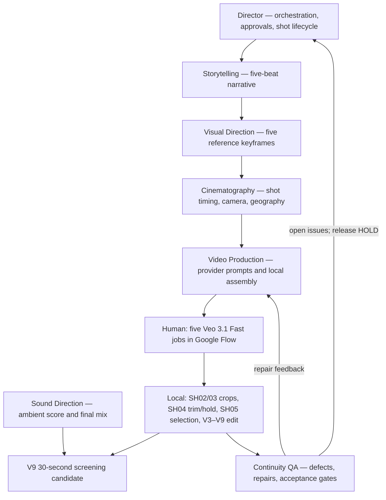

# The Last Light — V9 skill-guided production case study

> **Status: PROPOSED screening candidate.** Human-operated, skill-guided production; **not** independent seven-skill end-to-end acceptance. Production GO remains HOLD for additional provider jobs and release.

## Result

- **Film:** 30 seconds; five shots; H.264/AAC MP4, 960×540, 24 fps.
- **Preferred cut:** `The_Last_Light_V9_Directors_Cut_CANDIDATE.mp4`.
- **V9 SHA-256:** `64b1b593ab9d1534baf39940f067a9839fa7de34e703cae15377894d123d5235` (locally verified).
- **Budget:** 5 user-operated Veo 3.1 Fast generations × user-reported 20 credits = **100/100 credits**.
- **Media archive:** the V9 MP4 and source clips exist in the conversation's local review package. **The binary film is not uploaded by this documentation PR**; do not present the repository as hosting it.

## Skill responsibilities and human execution

The diagram represents **skill-guided responsibilities**, not evidence that seven independent agents executed these steps autonomously. The user operated Google Flow; local editing and soundtrack production were conducted in this conversation.

## Shot-by-shot evidence

| Shot | Film time | Action | Provider generation order | Local QA / caveat |
| --- | --- | --- | --- | --- |
| SH01 | 0–5 s | Dark town and tower | 5 | Faint amber lantern glow before activation — OPEN |
| SH02 | 5–11 s | Child discovers and picks up spark | 2 | Cropped reference-card labels; boundary QA pending |
| SH03 | 11–20 s | Child carries spark toward tower | 3 | Retimed source to 9-second slot; boundary QA pending |
| SH04 | 20–26 s | Spark released into lantern | 1 | Repeated action in source removed locally; held ending — OPEN |
| SH05 | 26–30 s | Town illuminates | 4 | Spotlight-like sweep, illumination softens at end — OPEN |

**Generation order:** SH04 → SH02 → SH03 → SH05 → SH01. Each video used the corresponding reference image already cataloged in [the image evidence README](README.md). Original reference-image bytes were preserved.

## Assembly history

- V3: SH04 generated footage and local repair.
- V4: SH02 generated footage integrated.
- V5: SH03 generated footage integrated.
- V6: SH05 generated footage integrated.
- V7: SH01 generated footage integrated; all five shots now derive from generated video.
- V8: original local ambient soundtrack added.
- V9: preferred screening cut; picture unchanged from V8; audio gain +7 dB and 0.8-second end fade.

**V9 technical verification:** 30.000 s, 960×540, 24 fps, H.264 video + AAC audio; measured mean audio −26.4 dBFS, peak −10.3 dBFS.

## Acceptance / evidence limitations

1. Visually inspect SH01 early lantern light and decide ACCEPTED_AS_IS vs NEEDS_FIX.
2. Inspect SH04 held ending and SH05 illumination/fade, including SH04→SH05 boundary.
3. Review SH02→SH03 and SH03→SH04 boundaries at normal playback speed.
4. Obtain final listening acceptance and explicit final-release authorization.
5. Archive original source MP4s, provider job IDs, model settings, credit receipts, hashes, editing commands, and approval ledger when available.
6. Run separate independent clean-context tests of the seven skills and their handoff contracts; this case study alone cannot establish autonomous pipeline acceptance.

**Evidence distinction:** the film demonstrates a human-in-the-loop image-to-video workflow and a technically verified screening candidate. It does **not** prove autonomous seven-skill orchestration, verified provider API execution, completed independent creative QA, or production release GO.

Existing historical fixtures, image provenance, and prior roadmap statuses are left unchanged. This page records a **new** production demonstration without retroactively rewriting historical NOT_RUN/BLOCKED results.
